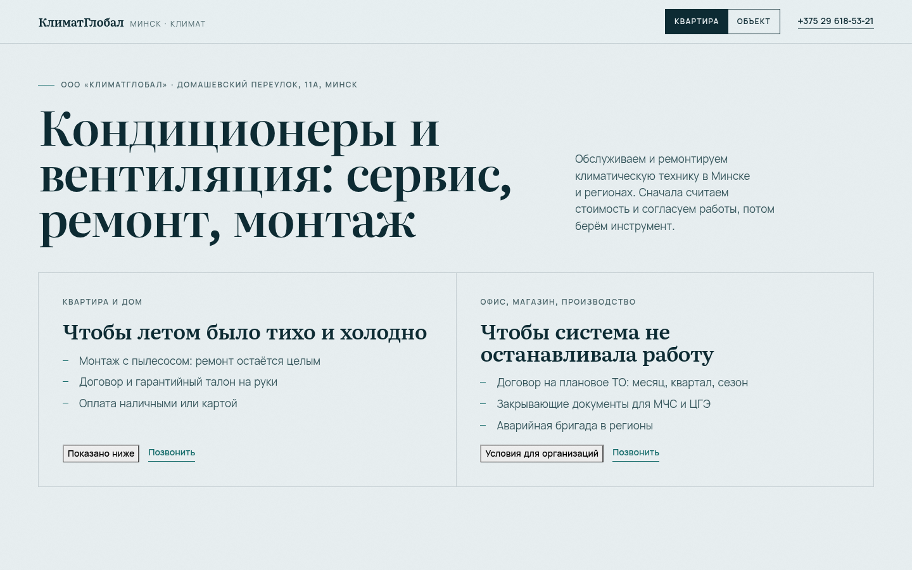
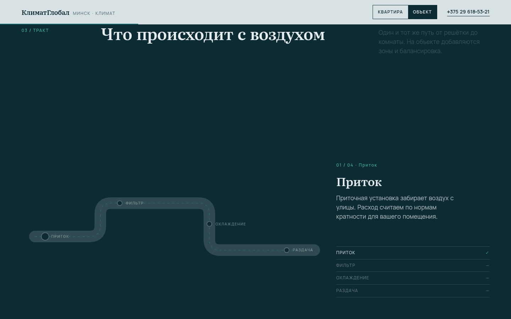

# КлиматГлобал — климат без сюрпризов

Сайт для ООО «КлиматГлобал» (Минск, Домашевский переулок, 11А): техническое обслуживание, ремонт и
проектирование кондиционеров и вентиляции. Две аудитории — квартиры и организации — разведены
переключателем, который меняет условия, аргументы и поля заявки.

**Живая версия:** https://romjjjke.github.io/klimatglobal/

## Что внутри

- Сплит-экран: «Квартира» и «Объект» с разными аргументами, выбор влияет на весь сайт.
- Пин-сцена «тракт воздуха»: скролл ведёт воздух от притока до раздачи, стадии 01–04.
- Регламент ТО из пяти пунктов и блок «что на руки» (акт, гарантийный талон, закрывающие).
- Условия для физлиц и юрлиц: договор, рассрочка по этапам, НДС, документы для МЧС и ЦГЭ.
- Форма: в режиме «Объект» добавляется поле организации, заявка уходит в WhatsApp.
- Все состояния: hover, focus-visible, active, disabled, loading, ошибки с `aria-invalid`, успех.

## Стек и качество

React + Vite + TypeScript, GSAP + ScrollTrigger (ленивая загрузка), Lenis. Шрифты самохостингом,
подмножества cyrillic + latin, метрические фолбэки.

Lighthouse mobile: performance 99, accessibility 100, best practices 100, SEO 100.
LCP 1,9 с, CLS 0, TBT 0. Ширины 320–1680 без переполнений.

| Десктоп 1440 | Мобильный 390 |
| --- | --- |
|  |  |
|  |  |

## Ограничения

Фотографий объектов нет — вся графика нарисована. Прайса клиент не дал, поэтому цифр на сайте нет:
только состав сметы и правило «называем до работ». График работы не указан в исходных данных, поэтому
на сайте его нет.
